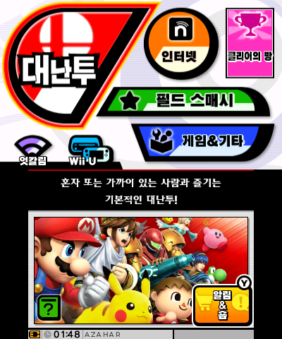
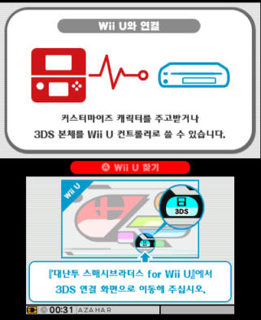
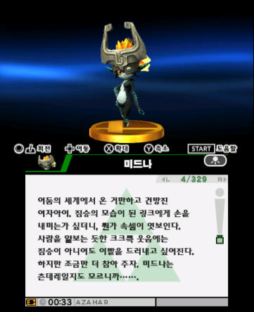
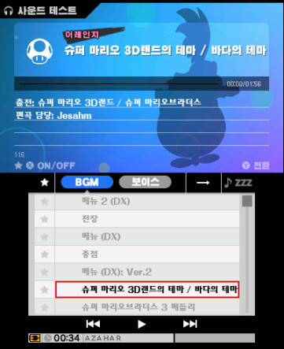

# 대난투 스매시브라더스 for Nintendo 3DS 한글 보완 패치

한국판 『대난투 스매시브라더스 for Nintendo 3DS』를 위한 비공식 팬 패치입니다. 한국판에 영어로 남아 있던 부분을 한국어로 바꾸고, 한국판에서 막혀 있던 「Wii U와 연결」 메뉴를 되살립니다.

**최신: 2026-11-25판** · [릴리스 다운로드](https://github.com/auseong325-design/ssb-for-3ds-korean-patch/releases/latest) · [패치 로그(이전 판과 달라진 점)](패치%20로그.md)

| | |
|:---:|:---:|
|  |  |
|  |  |

## 바뀌는 것

- 피규어(도감) 이름과 설명, 음악 정보 등 영어로 남아 있던 문장을 한국어로 바꿨습니다. 기존 한국판 공식 문장은 그대로 두었습니다.
- 메인 메뉴의 「Wii U」 버튼과 Wii U 연결 화면을 되살리고, 한국어 안내문을 넣었습니다. 게임 이름은 『대난투 스매시브라더스 for Wii U』로 표기합니다.
- 연결 실패·연결 끊기 확인 등 한국판에서 비어 있던 팝업 문구를 채웠습니다.
- 모자란 한글 글자는 Gothic A1(SIL OFL)로 그려 넣었습니다.

## 필요한 것

- 한국판 게임 카드 `CTR-P-AXCK` 덤프와 한국판 업데이트 **1.1.7** 덤프 (GodMode9 등으로 복호화해 꺼낸 본인 파일)
- [3DS 한글패치 매니저](https://github.com/auseong325-design/3ds-patch-universal-tool/releases) **v0.4.1 이상**
- 3DS: Luma3DS가 설치된 본체 / PC: Azahar
- DLC는 필요 없습니다. 있으면 합본 게임 파일에 함께 넣을 수 있습니다.

## 설치

릴리스의 `ssb3ds_ko_recipe.zip`과 본인 게임 파일을 3DS 한글패치 매니저 창에 함께 끌어다 놓고, 무엇을 만들지 고른 뒤 시작합니다. 매니저가 본인 게임 파일로 패치를 만듭니다.

- **패치 설치 (추천)**: SD 카드(`luma/titles/0004000000167C00`) 또는 Azahar 모드 폴더에 설치합니다. 3DS에서는 Luma의 Enable game patching을 켜고, 공식 업데이트 1.1.7을 설치해 둔 채 실행합니다.
- **합본 게임 파일**: 본편+업데이트(+DLC)+패치를 하나로 만듭니다. PC는 `.3ds`, 3DS는 `.cia`(키 폴더 필요)입니다.

자세한 과정과 주의할 점은 [설치 안내](설치%20안내.md)에 있습니다.

> **두 방식 중 하나만 쓰세요.** 공식 업데이트를 지운 채 SD 카드에 `luma/titles/0004000000167C00` 폴더를 남겨 두고 카드로 게임을 켜면 게임이 멈출 수 있습니다.

## 확인한 범위

- 패치 설치: Luma3DS v13.4 실기에서 실행을 확인했습니다. Azahar에서 메뉴, Wii U 연결 화면, 피규어 도감, 사운드 테스트를 확인했습니다.
- 합본 `.3ds`(DLC 포함): Azahar에서 메뉴, 추가 파이터, DLC 파이터 대전을 확인했습니다.
- 확인하지 않은 것: 합본 `.cia`의 실기 설치·실행, 실제 Wii U와의 연결.

## 권리 및 안내

이 프로젝트는 닌텐도 또는 원작 권리자의 허가·공인을 받지 않은 비공식 팬 패치입니다. 게임, 캐릭터, 상표의 권리는 각 권리자에게 있습니다. 패치는 어떠한 보증 없이 제공되며, 사용과 설치에 따른 결과는 사용자에게 있습니다.
