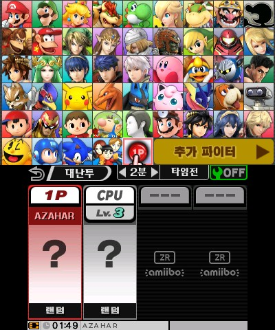
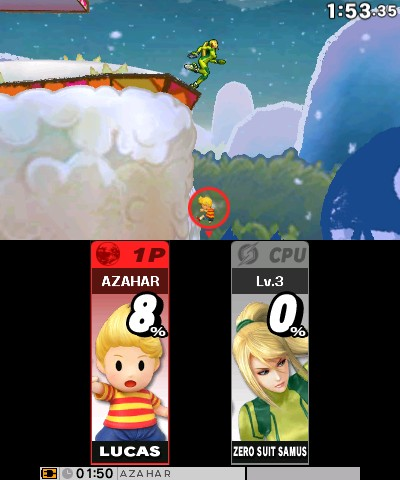
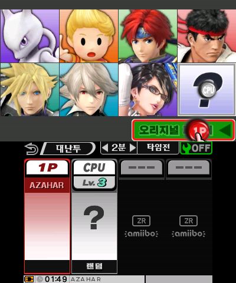
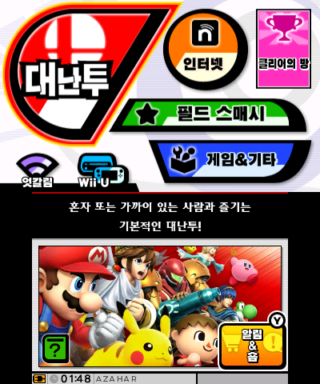
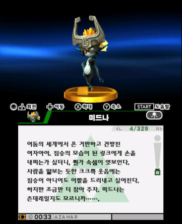
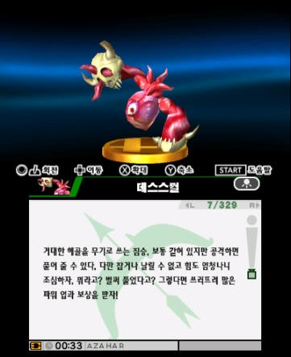
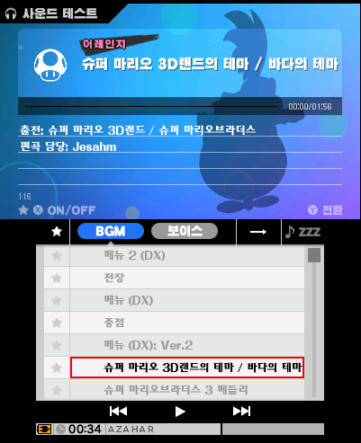
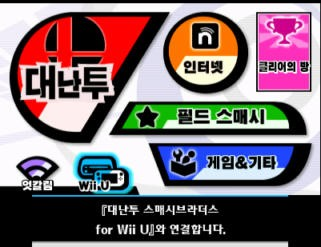
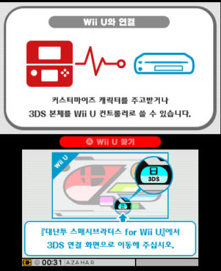

# 패치 로그

## 2026-11-25판 — GitHub 첫 릴리스

이전에 나눈 판 **r2(2026-10-04, SD 직접 설치형)** 와 비교해 바뀐 점입니다.

### 1. 설치 방식: 3DS 한글패치 매니저 + 레시피

- 패치 ZIP에 게임 데이터가 들어 있지 않습니다(약 190KB). [3DS 한글패치 매니저](https://github.com/auseong325-design/3ds-patch-universal-tool/releases) v0.4.1 이상에 본인 게임 파일과 함께 넣으면 그 PC에서 패치를 만듭니다.
- **패치 설치**: 표준 LayeredFS 구조(`luma/titles/0004000000167C00/code.ips`와 `romfs/`)로 SD 카드나 Azahar에 설치합니다. r2의 `files` 폴더 방식, r1의 SD 최상위 `ssb3ds-ko` 폴더는 쓰지 않습니다. 매니저는 같은 자리에 있던 예전 패치를 지우지 않고 백업 폴더로 옮깁니다.
- **합본 게임 파일**(새 기능): 본편+업데이트(+DLC)+패치를 하나로 만듭니다. PC는 `.3ds`, 3DS는 `.cia`입니다. 예전 「한글ROM 제작기」를 대신합니다.

| 합본: 캐릭터 선택 | 합본: DLC 파이터 대전 |
|:---:|:---:|
|  |  |
|  |  |

DLC를 넣은 합본 .3ds를 Azahar에서 실행한 화면입니다.

### 2. 번역

- Wii U판 한글 패치의 최신 번역을 반영했습니다(새 문장 36행, 용어 통일 20행: 던지기 도구, 축적 대미지, 익사이트바이크 등).
- 일본판과 설명이 같은 것으로 보이는 피규어 95개는 Wii U판 번역(일본어 원문 기준)을 쓰도록 바꿨습니다.
- 직접 번역한 849행을 다시 검토해 154행을 고쳤습니다. 공식 이름을 찾아 맞췄습니다(유랑아지, 초기화 폭탄, 봄버 열차, 팩메이즈 등).
- 한국어판에서 영어로 남아 있던 피규어 이름 50개와 그 설명, 팩맨 몬스터 이름을 한국어로 바꿨습니다.

| 피규어 (Wii U판 번역) | 피규어 (영어 이름 → 한국어) |
|:---:|:---:|
|  |  |
|  | |

### 3. Wii U 연결

- 메인 메뉴의 「Wii U」 버튼 설명과 연결 화면 안내문의 게임 이름을 『대난투 스매시브라더스 for Wii U』로 바꿨습니다.
- 한국판에서 비어 있던 팝업 문구를 채웠습니다: 연결 실패, 연결 끊기 확인, 연결이 끊어졌을 때, Wii U 본체를 찾지 못했을 때. r2에서 연결을 끊을 때 빈 창이 나오던 문제가 이것입니다.

| 메인 메뉴 | Wii U와 연결 |
|:---:|:---:|
|  |  |

팝업 문구는 본체 공용 글꼴로 그려집니다. 실제 Wii U와 연결해 본 화면은 아직 없습니다.

### 주의

두 방식 중 하나만 쓰세요. 공식 업데이트를 지운 채 SD 카드에 `luma/titles/0004000000167C00` 폴더를 남겨 두고 게임 카드로 실행하면 게임이 멈출 수 있습니다. 자세한 내용은 [설치 안내](설치%20안내.md)에 있습니다.

### 확인 범위

- 패치 설치: Luma3DS v13.4 실기에서 실행을 확인했습니다.
- 화면은 Azahar에서 찍은 것입니다.
- 확인하지 않은 것: 합본 `.cia`의 실기 설치·실행, 실제 Wii U와의 연결.
